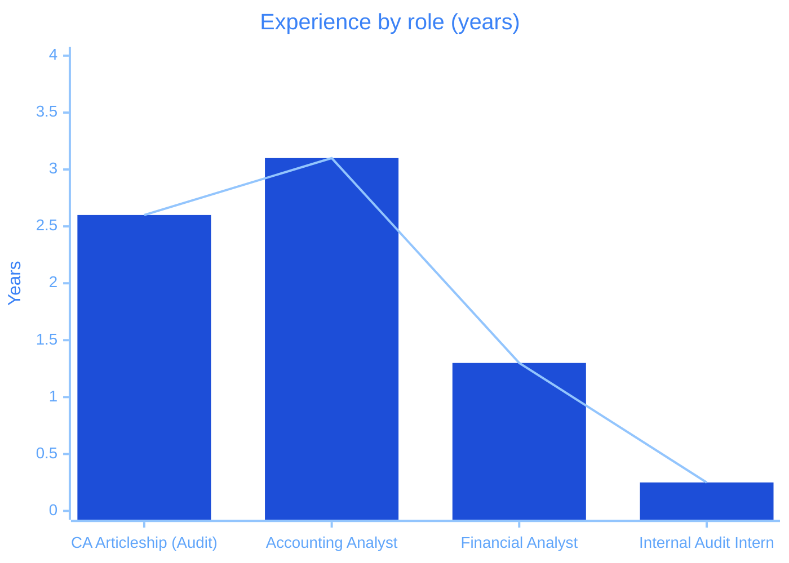
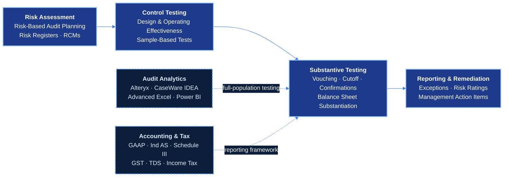
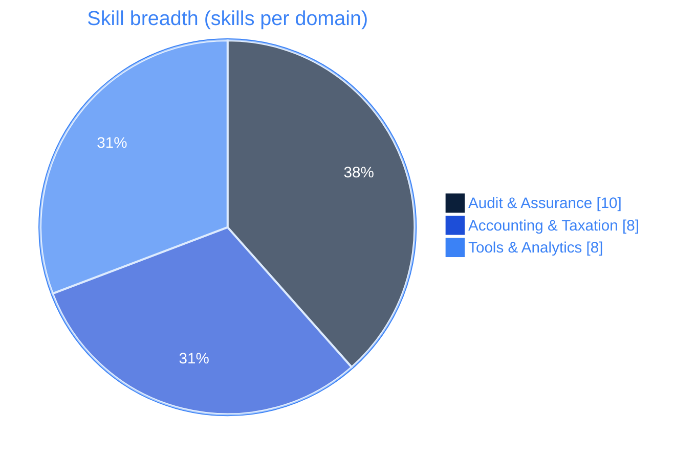

---

## Professional Summary

**Audit & Assurance** &nbsp;|&nbsp; **Internal Audit** &nbsp;|&nbsp; **Accounting & Taxation** &nbsp;|&nbsp; **Internal Controls** &nbsp;|&nbsp; **Risk & Compliance**

Audit and accounting professional with **2.5+ years** of financial statement audit experience (statutory, internal and tax audit) and **4+ years** in GAAP accounting, tax compliance and financial analysis across industries including FMCG, real estate, transportation, professional services and banking. Skilled in substantive testing, control testing, risk-based audit workpapers and data analytics using **Excel, CaseWare IDEA and Alteryx**. Recent internal audit experience at the **Illinois Housing Development Authority** spanning IT, finance, accounting and HR functions, including risk and control matrix evaluation and remediation follow-up. Completing an **M.S. in Audit & Advisory Services at DePaul University** (GPA 3.52, expected Jan 2027); planning to pursue **CPA licensure**.

**Core Competencies:**
- **Audit & Assurance:** Financial Statement Audit, Internal Audit, Substantive Testing, Vouching, Control Testing, Risk-Based Testing, Audit Workpapers
- **Internal Controls & Risk:** Risk & Control Matrices (RCMs), Design & Operating Effectiveness Testing, Risk Registers, Remediation Follow-up, AI Governance Testing
- **Accounting & Reporting:** GAAP, Ind AS, Schedule III, Financial Reporting, Month-End Close, Account Reconciliations, Variance Analysis
- **Taxation:** GST, TDS, Income Tax Compliance, Input Tax Credit (ITC) Reconciliation
- **Audit Analytics:** Microsoft Excel (Advanced), CaseWare IDEA, Alteryx, Power BI
- **Accounting & GRC Systems:** QuickBooks, Tally, Zoho Books, Optro

**Location:** Chicago, IL &nbsp;·&nbsp; **Authorized to work in the USA**

---

## Impact at a Glance

<table>
<tr>
<td align="center" width="16%"><h2>2.5+</h2>years in financial statement audit</td>
<td align="center" width="16%"><h2>4+</h2>years in accounting &amp; tax compliance</td>
<td align="center" width="16%"><h2>50</h2>client audit engagements</td>
<td align="center" width="16%"><h2>50,000+</h2>ledger entries in JE testing</td>
<td align="center" width="16%"><h2>500+</h2>vendor invoices reviewed monthly</td>
<td align="center" width="16%"><h2>INR 50 Cr+</h2>balances reconciled</td>
</tr>
</table>

---

## Audit & Assurance Expertise

---

## Skills & Tools

| **Category** | **Skills** |
|:------------|:----------|
| **Audit & Assurance** | Financial Statement Audit, Internal Audit, Substantive Testing, Vouching, Control Testing, Risk-Based Testing, Audit Workpapers, Risk & Control Matrices, Account Reconciliations, Financial Statement Review |
| **Accounting & Taxation** | GAAP, Ind AS, Financial Reporting, Month-End Close, Variance Analysis, GST, TDS, Income Tax Compliance |
| **Standards & Frameworks** | Standards on Auditing (SA 505 confirmations), Schedule III, Financial Statement Assertions, AI Governance (access, data sharing, acceptable use, output reliability, bias) |
| **Audit Analytics** | Microsoft Excel (Advanced), CaseWare IDEA, Alteryx, Power BI |
| **Accounting & GRC Systems** | QuickBooks, Tally, Zoho Books, Optro |

---

## Professional Experience

  

<b>Internal Audit Intern · Illinois Housing Development Authority (IHDA)</b> &nbsp;|&nbsp; Jun 2026 – Aug 2026 &nbsp;|&nbsp; Chicago, IL &nbsp;(click to collapse)

 

<table>
<tr>
<td align="center" width="25%"><h3>5</h3>departments audited</td>
<td align="center" width="25%"><h3>15+</h3>disbursements tested</td>
<td align="center" width="25%"><h3>15+</h3>risks tracked in Optro</td>
<td align="center" width="25%"><h3>8</h3>reconciliation exceptions resolved</td>
</tr>
</table>

| Focus | What I did |
|:--|:--|
| **Risk-based audits** | Supported risk-based internal audits across **five departments** (IT, Multifamily, Accounting, Finance and HR), performing control testing, evidence review and workpaper documentation |
| **AI governance** | Tested the organization's **AI copilot** against governance requirements (access, data sharing, acceptable use, output reliability and bias metrics); documented exceptions with risk ratings, remediation timelines and management action items |
| **Disbursement testing** | Tested **15+ disbursements** for approval, supporting documentation and correct coding, using sample-based control tests of **10+ items** each |
| **Controls & remediation** | Evaluated **Risk & Control Matrices (RCMs)**, acceptable-use policies and control effectiveness of software deployments; followed up with control owners on remediation of **3+ audit findings** |
| **Assertion testing** | Executed **design and operating effectiveness** testing across key financial statement assertions; documented audit trails and resolved **8 balance sheet reconciliation exceptions** during fieldwork |
| **Risk register** | Maintained the risk register in **Optro** (**15+ risks** tracked by rating, control owner and remediation status across business units); authored an Optro user manual to standardize audit procedures |

`Internal Audit` `Control Testing` `RCMs` `AI Governance` `Disbursement Testing` `Workpapers` `Optro` `Remediation Follow-up`

<b>Financial Analyst · Nirved Ventures LLP</b> &nbsp;|&nbsp; Jul 2023 – Nov 2024 &nbsp;(click to expand)

 

<table>
<tr>
<td align="center" width="33%"><h3>500+</h3>vendor invoices reviewed monthly</td>
<td align="center" width="33%"><h3>INR 25 Cr+</h3>post-year-end spend tested</td>
<td align="center" width="33%"><h3>3</h3>tax regimes filed (GST · TDS · Income Tax)</td>
</tr>
</table>

| Focus | What I did |
|:--|:--|
| **GST review** | Reviewed **500+ vendor invoices monthly** for GST input-credit eligibility and coordinated tax reconciliations with external auditors |
| **Cutoff testing** | Performed subsequent disbursements testing on post-year-end expenditures exceeding **INR 25 Cr+**, verifying invoice dates and receiving logs to validate completeness of accrued liabilities and cutoff integrity |
| **Tax compliance** | Prepared **GST, TDS and income tax filings** in Tally, Zoho Books and QuickBooks, maintaining supporting documentation for compliance reviews |

`GST` `TDS` `Income Tax` `Subsequent Disbursements` `Cutoff Testing` `Tally` `Zoho Books` `QuickBooks`

<b>Accounting Analyst · Dilly Hardware Company</b> &nbsp;|&nbsp; Jun 2020 – Jul 2023 &nbsp;(click to expand)

 

<table>
<tr>
<td align="center" width="33%"><h3>INR 50 Cr+</h3>debtor/creditor balances reconciled</td>
<td align="center" width="33%"><h3>SA 505</h3>external confirmations</td>
<td align="center" width="33%"><h3>Ind AS</h3>&amp; Schedule III reporting</td>
</tr>
</table>

| Focus | What I did |
|:--|:--|
| **Statutory audit support** | Facilitated statutory audit **PBC deliverables**, performing balance sheet substantiation and multi-party debtor/creditor reconciliations across **INR 50 Cr+** balances under **Ind AS and Schedule III** guidelines |
| **Confirmations** | Assisted engagement seniors with **Standards on Auditing (SA 505)** compliance, drafting external bank and vendor confirmation requests and resolving ledger-to-subledger reconciling differences |
| **Tax accruals** | Reconciled purchase registers with **GSTR-2B** reports to verify Input Tax Credit (ITC) eligibility and ensure accurate period-end statutory tax accruals |

`PBC` `Balance Sheet Substantiation` `Reconciliations` `SA 505` `Ind AS` `Schedule III` `GSTR-2B` `ITC`

<b>Article Assistant (Audit), CA Articleship · Jain Sharma & Company, Chartered Accountants</b> &nbsp;|&nbsp; Aug 2017 – Mar 2020 &nbsp;(click to expand)

 

<table>
<tr>
<td align="center" width="33%"><h3>50</h3>client engagements</td>
<td align="center" width="33%"><h3>50,000+</h3>ledger entries tested in Alteryx</td>
<td align="center" width="33%"><h3>2.5+</h3>years of statutory, internal &amp; tax audit</td>
</tr>
</table>

| Focus | What I did |
|:--|:--|
| **Audit engagements** | Performed statutory, internal and tax audit procedures across **50 client engagements** over **2.5+ years** in FMCG, real estate, transportation, other services, professional practices (doctors, architects) and banking, including vouching, substantive testing and financial statement review |
| **Workpapers** | Prepared audit working papers supporting risk-based testing and account reconciliations; identified financial reporting exceptions |
| **Audit analytics** | Engineered automated **Alteryx** workflows to perform full-population journal entry testing across **50,000+ ledger entries**, isolating high-risk transactions, round-sum postings and weekend adjustments for senior review |

`Statutory Audit` `Internal Audit` `Tax Audit` `Vouching` `Substantive Testing` `JE Testing` `Alteryx`

---

## Projects

| **Project** | **What it does** | **Tools** |
|:-----------|:----------------|:---------|
| **Financial Error Detection** | Automated audit tests that identify accounting errors, anomalies and irregularities in financial data | `CaseWare IDEA` |
| **SEC Financial Statement Analysis** | Comparative financial statement analysis of consumer discretionary companies | `SEC Filings` `Excel` |

### IT Audit & Controls on GitHub

| **Repository** | **What it does** | **Tech** |
|:--------------|:----------------|:--------|
| [**AWS IAM Auditing**](https://github.com/rishabhl3116-a11y/aws-iam-auditing) | Collects the IAM credential report from every active AWS Organizations account and emails a consolidated access-review report | `Python` `AWS IAM` `Jinja2` `Docker` |
| [**AWS IAM Access Keys Audit**](https://github.com/rishabhl3116-a11y/aws-iam-keys-audit) | Lambda that ages out IAM access keys: deactivates keys past the max age, deletes them after a waiting period, and reports every action via SNS | `Python` `AWS Lambda` `CloudFormation` `SNS` |
| [**CIS Compliance Config Rule**](https://github.com/rishabhl3116-a11y/config-rule-inspec-cis-audit-lambda) | Custom AWS Config rule that runs Chef InSpec CIS benchmark audits through Systems Manager to monitor OS compliance | `Python` `AWS Config` `Systems Manager` `InSpec` |
| [**Sentinel**](https://github.com/rishabhl3116-a11y/sentinel) | Log-analytics pipeline with MITRE ATT&CK-mapped rules and ML anomaly detection, scoring detection precision and recall against labeled ground truth | `Python` `Streamlit` `scikit-learn` |
| [**AI-SOC**](https://github.com/rishabhl3116-a11y/ai_soc) | Local security operations platform with event ingestion, AI-assisted triage, incident correlation, analyst review and role-based access | `Python` `Docker` `Ollama` `PostgreSQL` |
| [**SOC Automation Lab**](https://github.com/rishabhl3116-a11y/soc-automation-lab) | Automated detection, case management and alert enrichment workflow built on Wazuh, TheHive and Shuffle | `Wazuh` `TheHive` `Shuffle` `VirusTotal` |

---

## GitHub Activity

 

---

## Contribution Activity

<!-- The blue snake SVGs are generated by .github/workflows/snake.yml into the "output" branch. -->

  <picture>
    <source media="(prefers-color-scheme: dark)" srcset="https://raw.githubusercontent.com/rishabhl3116-a11y/rishabhl3116-a11y/output/snake-blue-dark.svg" />
    <source media="(prefers-color-scheme: light)" srcset="https://raw.githubusercontent.com/rishabhl3116-a11y/rishabhl3116-a11y/output/snake-blue.svg" />
    
  </picture>

---

## Education

| **Degree** | **Institution** | **Duration** |
|:----------|:---------------|:------------:|
| **Master of Science in Audit & Advisory Services** (GPA 3.52) | DePaul University, Chicago, IL | Jan 2025 – Jan 2027 (expected) |
| **Master of Commerce** | University of Rajasthan, Jaipur, India | 2021 – 2023 |
| **Bachelor of Commerce** | University of Rajasthan, Jaipur, India | 2016 – 2019 |

---

## Let's Connect

**Location:** Chicago, IL &nbsp;|&nbsp; **Email:** [Rishabhl3116@gmail.com](mailto:Rishabhl3116@gmail.com) &nbsp;|&nbsp; **Phone:** [+1 (973) 978-5785](tel:+19739785785)

